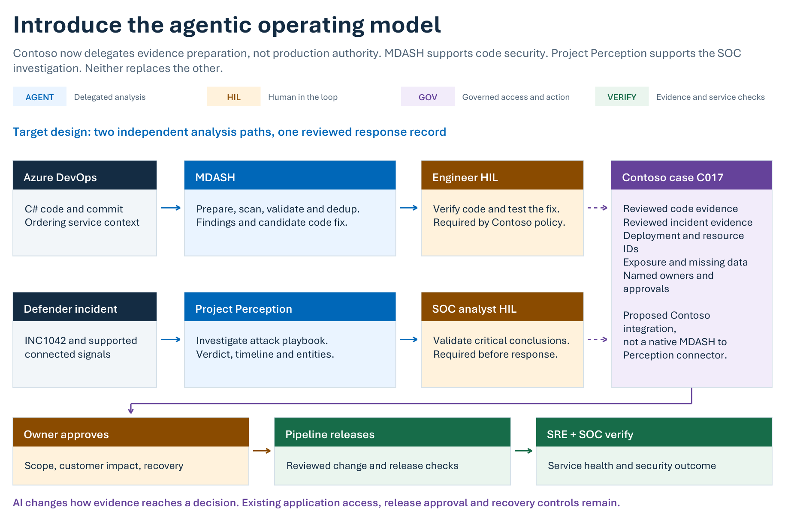

# Agentic AI Security with Microsoft MDASH and Project Perception

### Session resources by Razi Rais

Companion resources for Razi Rais's O'Reilly live session exploring complementary applications of agentic AI security: MDASH for application security and vulnerability discovery, and Project Perception for coordinated security operations.

The session connects technical concepts with practical evaluation, emphasizing verified evidence, bounded authority, human oversight, and AI governance.

**[View the O'Reilly session](https://learning.oreilly.com/live-events/agentic-ai-security-with-microsoft-mdash-and-project-perception/0642572457624/)**

## Architecture at a glance

The Contoso example shows how application security findings and incident evidence can support a shared investigation while preserving distinct agent responsibilities, human decisions, and governance controls. Select the architecture image to open the complete case study.

## Explore the resources

| Resource | Purpose |
|---|---|
| [Contoso case study](case-study/contoso-mdash-perception-case-study.pdf) | Follow the existing SOC workflow, understand its operational pain, and examine the proposed agentic transformation through annotated architecture and decision points. |
| [Interactive activity](https://razi-rais.github.io/microsoft-agentic-soc/activity/) | Reinforce the session concepts through a drag and drop matching exercise. |

Start with the case study, then [open the interactive activity in your browser](https://razi-rais.github.io/microsoft-agentic-soc/activity/). No download is required. You can also run the activity locally by downloading or cloning the repository and opening `activity/index.html` in your browser.

The Contoso scenario is fictional. Its proposed integration does not imply a native connection between MDASH and Project Perception.

## Connect with Razi Rais

Explore additional training, sessions, and advisory conversations.

**[Website](https://razibinrais.com)** | **[LinkedIn](https://www.linkedin.com/in/razirais/)**

## Rights and permitted use

Copyright (c) 2026 Razi Rais. All rights reserved, except where otherwise indicated.

Original session materials are provided for personal study under the terms in [LICENSE](LICENSE). Redistribution, republication, resale, or inclusion in other training materials requires prior written permission from Razi Rais, except where applicable law or platform terms provide otherwise.

Retain author attribution and copyright notices in every permitted use. **Attribution alone does not grant permission to redistribute.**

Third party images, trademarks, and referenced materials remain subject to their respective owners' rights and terms.
